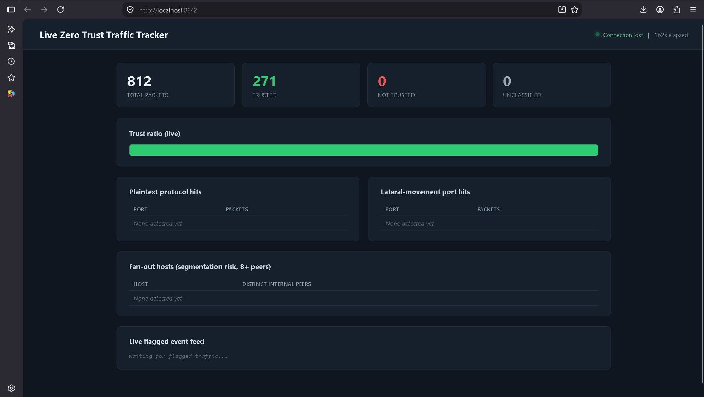
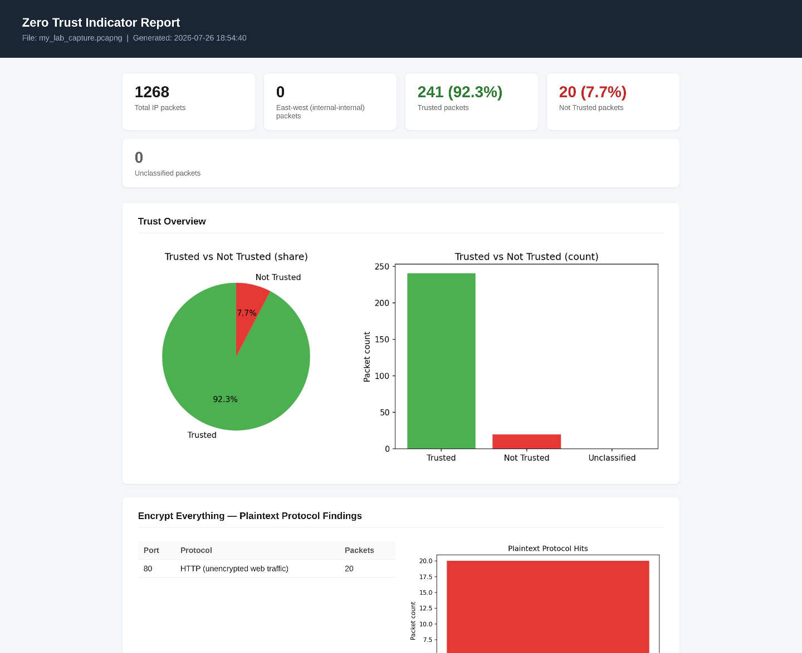
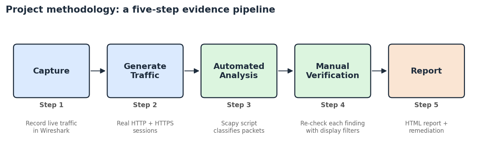
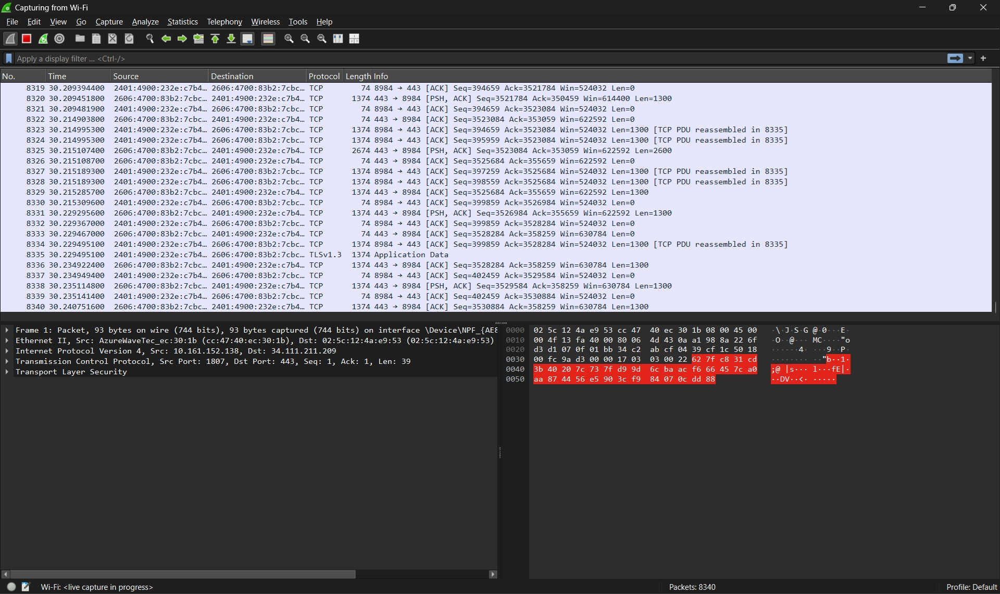
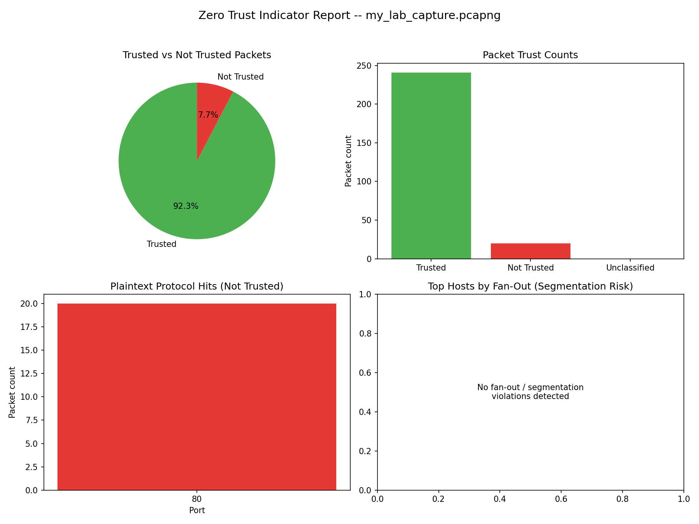
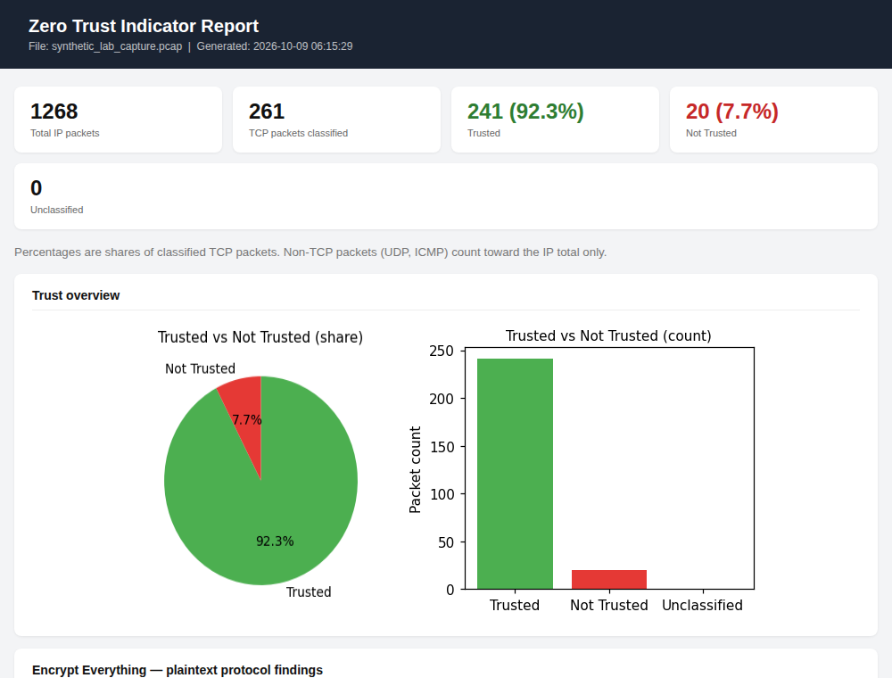

# Zero Trust at the Packet Level: Wireshark Verification and Live Traffic Monitoring

**What does "never trust, always verify" actually look like on the wire? This project captures real traffic in Wireshark, classifies every packet against the NIST SP 800-207 Zero Trust tenets with a Python/Scapy engine, and re-checks every automated finding by hand.**

[](https://github.com/lohitashva2004-netizen/zero-trust-packet-analysis/actions)


Course project for *21ECC402P: Computer Communication and Network Security*, B.Tech ECE (Data Science specialisation), SRM Institute of Science and Technology, Vadapalani. Faculty guide: Dr. Priti Rishi.

<p align="center">
  
  
</p>

---

## The idea

Most Zero Trust material stays at the policy-and-diagram level. This project asks a more concrete question: **which packets, in a real capture, show a Zero Trust tenet being upheld or violated?** It builds a small lab, generates both compliant (HTTPS) and non-compliant (plaintext HTTP) traffic, and turns the five NIST tenets into things you can filter for in Wireshark and count in code.

## What's here

| Tool | What it does |
|---|---|
| **Wireshark workflow** ([docs/methodology.md](docs/methodology.md)) | Display filters and stream-following to confirm each tenet by hand. This is the authoritative check. |
| **Offline analyzer** (`check_zero_trust_indicators.py`) | Streams a `.pcap/.pcapng`, classifies every TCP packet as Trusted / Not Trusted / Unclassified, reads TLS versions out of raw handshake bytes, counts per-host fan-out, and writes a single self-contained HTML report with charts and a tenet scorecard. |
| **Live tracker** (`live_zero_trust_tracker.py`) | Sniffs an interface with Scapy and serves a dashboard that refreshes every 1.5 s: running counts, a live trust-ratio bar, plaintext and lateral-movement tables, and a scrolling event feed with timestamp, source, destination and reason. |

Both tools share one classification engine (`src/zt/core.py`), so a live session and a saved capture always agree.

## How packets are classified

| Verdict | Ports |
|---|---|
| 🟥 **Not Trusted** | Plaintext: 21 FTP · 23 Telnet · 80 HTTP · 69 TFTP · 143 IMAP · 110 POP3. Lateral movement: 445 SMB · 135 MS-RPC · 3389 RDP |
| 🟩 **Trusted** | Encrypted: 443 · 993 · 995 · 22 · 465 · 636 |
| ⬜ **Unclassified** | Everything else |

Beyond ports, the engine reads **TLS hellos from raw bytes** (flagging deprecated TLS 1.0/1.1 and detecting TLS 1.3 via the `supported_versions` extension) and counts **fan-out**: how many distinct private peers each host contacts, as a micro-segmentation signal.



## Quick start

```bash
git clone https://github.com/lohitashva2004-netizen/zero-trust-packet-analysis.git
cd zero-trust-packet-analysis
pip install -e ".[dev]"
```

**1. Analyse a capture, no live sniffing needed.** A synthetic sample capture is included:

```bash
python check_zero_trust_indicators.py samples/synthetic_lab_capture.pcap -o report.html
# 1268 IP packets | trusted 241 (92.3%) | not trusted 20 (7.7%) | unclassified 0
```

Use your own Wireshark capture (*File → Save As → .pcapng*) the same way. Open the HTML in any browser.

**2. Try the live dashboard without privileges:**

```bash
python live_zero_trust_tracker.py --demo        # synthetic traffic, opens http://localhost:8642
```

**3. Monitor your real network.** Live capture needs elevated privileges. On Windows install [Npcap](https://npcap.com) and run the terminal as Administrator; on Linux/macOS use `sudo`.

```bash
python live_zero_trust_tracker.py --iface "Wi-Fi"      # Windows interface name as shown in Wireshark
sudo python live_zero_trust_tracker.py --iface eth0 --port 8500
```

**4. Reproduce the lab.**

```bash
python -m http.server 8080          # a deliberately plaintext server
curl http://localhost:8080
python live_zero_trust_tracker.py --plaintext-port 8080:HTTP-alt   # port 8080 isn't flagged by default
```

Options: `--include-ipv6` (analyse IPv6 too; default is IPv4 only), `--plaintext-port PORT[:NAME]` (repeatable), `--no-open`, `--port`.

**5. Run the tests** (48, no network or privileges needed):

```bash
pytest -q
```

## Results

| Metric | Value |
|---|---|
| Total IP packets analysed | 1268 |
| Trusted | 241 (92.3%) |
| Not Trusted | 20 (7.7%) |
| Not Trusted breakdown | 20 plaintext HTTP packets, all on port 80 |

Percentages are shares of the 261 classified **TCP** packets; the other IP packets are non-TCP and only count toward the total.

| NIST SP 800-207 tenet | Result | Evidence |
|---|---|---|
| Verify Explicitly | ✅ Upheld | TLS 1.2 / 1.3 handshakes on encrypted sessions |
| Least Privilege | ✅ Upheld (manual review) | No unexpected host-to-service patterns observed |
| Assume Breach | ✅ Upheld | No SMB, RDP or MS-RPC traffic |
| Micro-segmentation | ✅ Upheld | No host exceeded the fan-out threshold |
| Encrypt Everything | ❌ **Violated** | 20 plaintext HTTP packets on port 80; a deprecated TLS 1.0 handshake seen beside TLS 1.2 traffic |

<p align="center">
  
  
</p>

**Recommended remediation:** migrate the service from HTTP to HTTPS (TLS ≥ 1.2), disable TLS 1.0/1.1 everywhere, and add VLAN-based micro-segmentation before scaling beyond a lab. Details in [docs/findings.md](docs/findings.md).

The repo's offline report on the bundled synthetic capture looks like this:

<p align="center"></p>

## Repository layout

```
├── check_zero_trust_indicators.py   offline analyzer (thin wrapper)
├── live_zero_trust_tracker.py       live dashboard (thin wrapper)
├── src/zt/
│   ├── core.py      ports, classify(), fan-out, thread-safe TrafficStats
│   ├── tls.py       TLS ClientHello / ServerHello parser
│   ├── report.py    pcap analysis + self-contained HTML report
│   ├── live.py      Scapy sniffer + dashboard HTTP server
│   └── synth.py     synthetic packet / TLS builders (tests, demos)
├── samples/         synthetic capture + its generated report
├── scripts/         make_sample_pcap.py
├── tests/           48 unit tests
└── docs/            methodology, findings, report figures
```

## Limitations

Stated up front, because understanding what a method *cannot* see matters as much as what it can.

- **Port-based verdicts are a heuristic.** Port 443 does not prove TLS, and HTTPS on a non-standard port (8443, say) is Unclassified. Encrypted traffic on a plaintext port, or plaintext on 443, is misjudged. That is why every finding was confirmed in Wireshark.
- **Single-packet TLS parsing.** A handshake split across TCP segments is not parsed.
- **IPv4 by default.** IPv6 is opt-in (`--include-ipv6`); a dual-stack capture analysed without it under-counts.
- **Least Privilege and policy are invisible to a capture.** The offline scorecard marks that tenet *manual review*; it needs access-policy context, not packets.
- **Fan-out is a coarse proxy** for segmentation, using a fixed threshold (8 peers) and RFC 1918 ranges.
- **Lab scale.** One machine, one capture, a deliberately planted violation. These results demonstrate the method, not the security posture of a real enterprise.
- **Loopback is not sniffed by default.** Traffic to `localhost` needs a loopback-capable capture adapter (Npcap) to appear at all.
- **The original capture is not published**, because it contains real traffic. The bundled sample is synthetic and built to reproduce the headline numbers.

## Roadmap

- [ ] Verify TLS by handshake rather than by port (catch TLS on odd ports, plaintext on 443)
- [ ] Reassemble TCP streams for fragmented handshakes; add cipher-suite and certificate checks
- [ ] Flow-level features (new-destination rate, beaconing) alongside per-packet rules
- [ ] Export alerts (JSON / syslog) and a persistent history instead of in-memory counters
- [ ] Enforce a micro-segmentation policy on a small multi-VLAN lab and measure blocked lateral movement

## Team

- Lohitashva V S
- Jayaprakash L
- Vishal M

**Faculty guide:** Dr. Priti Rishi, Assistant Professor, Dept. of ECE, SRM IST Vadapalani

## References

- S. Rose, O. Borchert, S. Mitchell, S. Connelly, *Zero Trust Architecture*, NIST SP 800-207, 2020.
- K. Moriarty, S. Farrell, *Deprecating TLS 1.0 and TLS 1.1*, RFC 8996, 2021.
- E. Rescorla, *The Transport Layer Security (TLS) Protocol Version 1.3*, RFC 8446, 2018.
- Wireshark display filter reference and Scapy documentation.

## License

MIT, see [LICENSE](LICENSE).
