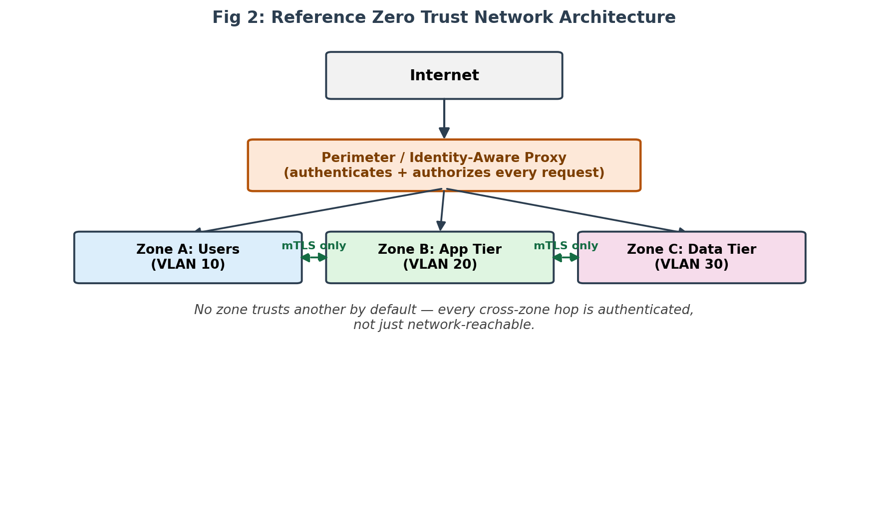

# Methodology


Every automated finding is treated as a **candidate, not a conclusion**. It only enters the results after it has been re-checked by hand in Wireshark with the matching display filter.

## 1. Lab setup and traffic generation

A small local lab on one machine:

```bash
python -m http.server 8080       # deliberately serves plaintext HTTP
curl http://localhost:8080       # issue a real request against it
```

While Wireshark captured the live interface, ordinary HTTPS browsing provided an encrypted control example.

> **Loopback note.** Traffic to `localhost` never touches the Wi-Fi adapter. To see the 8080 exchange itself in Wireshark on Windows, capture on the *Npcap Loopback Adapter*. Port 8080 is also not in the tracker's default plaintext table (see `--plaintext-port` below).

## 2. Manual verification in Wireshark

| Question | Display filter |
|---|---|
| Any classic plaintext protocols? | `http \|\| telnet \|\| ftp` |
| Plaintext HTTP on a specific port | `tcp.port == 80` |
| TLS handshakes: which versions are negotiated? | `tls.handshake.type == 1` (ClientHello), `tls.handshake.type == 2` (ServerHello) |
| Deprecated TLS negotiated | `tls.handshake.type == 2 && tls.handshake.version < 0x0303` |
| Lateral-movement services | `tcp.port in {445 135 3389}` |
| Who talks to whom? | *Statistics → Conversations* (IPv4 / TCP tabs) |
| Exact exposed content | right-click a packet → *Follow → TCP Stream* |


## 3. Automated classification

Every TCP segment gets one verdict, from its ports:

| Verdict | Rule (ports) |
|---|---|
| **Not Trusted** | plaintext: 21 FTP, 23 Telnet, 80 HTTP, 69 TFTP, 143 IMAP, 110 POP3, or lateral movement: 445 SMB, 135 MS-RPC, 3389 RDP |
| **Trusted** | encrypted: 443, 993, 995, 22, 465, 636 |
| **Unclassified** | anything else |

Plaintext/lateral rules are checked first, so a segment touching both a risky and an encrypted port is flagged.

On top of the verdict the engine also:

- **Reads TLS hellos from raw bytes.** A ServerHello gives the *negotiated* version (TLS 1.3 is detected through the `supported_versions` extension, because its legacy version field still says 1.2). A ClientHello gives the highest *offered* version. The record-layer version is ignored on purpose: modern clients send `0x0301` there for compatibility, and trusting it would mislabel healthy TLS 1.2/1.3 sessions as TLS 1.0.
- **Counts fan-out.** For each host, the number of distinct *private* peers it talks to (RFC 1918, plus IPv6 ULA with `--include-ipv6`). Eight or more flags a possible micro-segmentation violation.

Both the offline report and the live tracker share one engine (`zt.core.TrafficStats`), so they cannot disagree.

## 4. Mapping tenets to packet evidence

| NIST SP 800-207 tenet | Packet-level indicator |
|---|---|
| Verify Explicitly | TLS 1.2/1.3 handshakes on sessions |
| Least Privilege | *Needs access-policy context; assessed by manual review* |
| Assume Breach | No SMB / RDP / MS-RPC traffic |
| Micro-segmentation | No host exceeds the fan-out threshold |
| Encrypt Everything | No plaintext protocol ports; no deprecated TLS negotiated |

## Reference architecture



The conceptual basis for the evaluation: an identity-aware proxy authenticates and authorises every request before it reaches any of three VLAN-segmented zones, and zones talk to each other over mutual TLS only.
